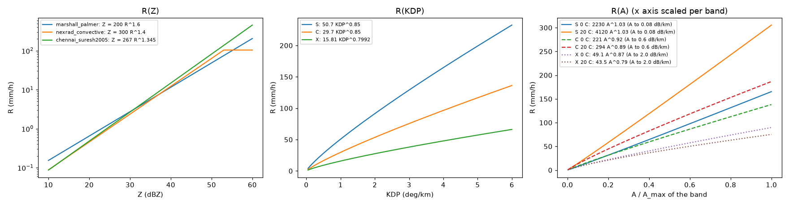
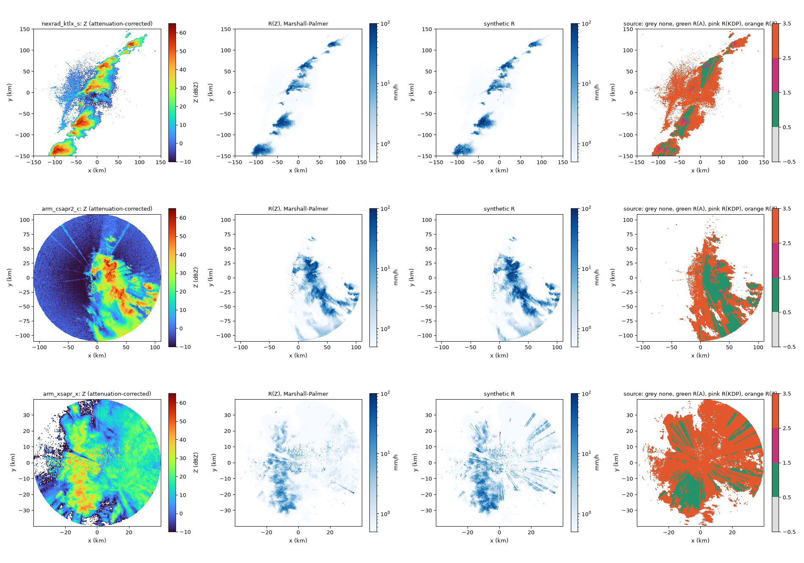
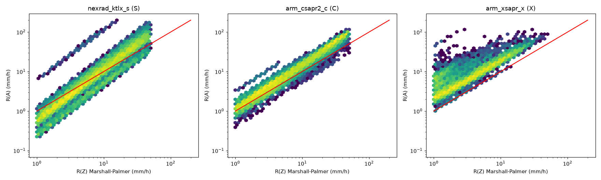

# radarwow-estimation

**radar-wow stage 6: Rain-rate estimators, VPR, blockage, hybrid scan.** R(Z), R(KDP), R(A), R(Z,ZDR) and a synthetic blend; vertical profile correction; beam blockage; lowest-usable-tilt selection.

Part of [radar-wow](https://github.com/manmeet3591/radar-wow), a set of repos that together build a radar QPE system that works for S, C and X band radars.
Every algorithm is one class implementing one paper, with the same interface: it takes an xradar sweep or volume with canonical moment names, declares the bands and moments it needs, and records provenance.

## Sub-components

| sub-component | algorithm | source | DOI | status |
|---|---|---|---|---|
| R(Z) presets | `ZRRelation` | Marshall & Palmer 1948; Fulton et al. 1998; Suresh et al. 2005 (Chennai) | [doi:10.1175/1520-0434(1998)013<0377:TWRA>2.0.CO;2](https://doi.org/10.1175/1520-0434(1998)013<0377:TWRA>2.0.CO;2) | implemented + notebook |
| R(KDP) | `RainRateKDP` | Ryzhkov & Zrnic 1996; band defaults as documented in Py-ART | [doi:10.1175/1520-0450(1996)035<2080:AORMTU>2.0.CO;2](https://doi.org/10.1175/1520-0450(1996)035<2080:AORMTU>2.0.CO;2) | implemented + notebook |
| R(A) | `RainRateA` | Ryzhkov, Diederich, Zhang & Simmer 2014, JTECH | [doi:10.1175/JTECH-D-13-00038.1](https://doi.org/10.1175/JTECH-D-13-00038.1) | implemented + notebook |
| R(Z,ZDR) (S band) | `RainRateZZDR` | Ryzhkov, Giangrande & Schuur 2005; NEXRAD DP-QPE coefficients | [doi:10.1175/JAM2213.1](https://doi.org/10.1175/JAM2213.1) | implemented + notebook |
| synthetic blend | `SyntheticRainRate` | Zhang et al. 2020, J. Hydrometeor. (MRMS logic) | [doi:10.1175/JHM-D-19-0194.1](https://doi.org/10.1175/JHM-D-19-0194.1) | implemented + notebook |
| HCA-driven rate | `HCADrivenRainRate` | Giangrande & Ryzhkov 2008; NEXRAD Build 18/19 table (Grams et al. 2019) | [doi:10.1175/2008JAMC1753.1](https://doi.org/10.1175/2008JAMC1753.1) | planned |
| VPR correction | `ZhangQi2010VPR` | Zhang & Qi 2010, J. Hydrometeor. | [doi:10.1175/2010JHM1201.1](https://doi.org/10.1175/2010JHM1201.1) | implemented + notebook |
| beam blockage | `DEMBeamBlockage` | Bech et al. 2003, JTECH | [doi:10.1175/1520-0426(2003)020<0845:TSOSPW>2.0.CO;2](https://doi.org/10.1175/1520-0426(2003)020<0845:TSOSPW>2.0.CO;2) | planned |
| hybrid scan | `HybridScan` | Fulton et al. 1998 (WSR-88D) | [doi:10.1175/1520-0434(1998)013<0377:TWRA>2.0.CO;2](https://doi.org/10.1175/1520-0434(1998)013<0377:TWRA>2.0.CO;2) | planned |
| accumulation (no advection) | `accumulate` | scan-hold accumulation |  | implemented + notebook |
| advection-corrected accumulation | `advection_accumulate` | Anagnostou & Krajewski 1999, JTECH; pysteps Lucas-Kanade (Pulkkinen et al. 2019) | [doi:10.1175/1520-0426(1999)016<0189:RTRREP>2.0.CO;2](https://doi.org/10.1175/1520-0426(1999)016<0189:RTRREP>2.0.CO;2) | implemented + notebook |

## Install

```bash
pip install git+https://github.com/manmeet3591/radarwow-core git+https://github.com/manmeet3591/radarwow-estimation
```

## Notebooks (free data, S / C / X band)

- [`notebooks/01_rain_rate_s_c_x.ipynb`](notebooks/01_rain_rate_s_c_x.ipynb): open in Colab via `https://colab.research.google.com/github/manmeet3591/radarwow-estimation/blob/main/notebooks/01_rain_rate_s_c_x.ipynb`
- Used and checked in the [radarwow-verify notebook `02_ktlx_20220505_vpr.ipynb`](https://github.com/manmeet3591/radarwow-verify/blob/main/notebooks/02_ktlx_20220505_vpr.ipynb)
- Used and checked in the [radarwow-verify notebook `03_ktlx_20220505_advection.ipynb`](https://github.com/manmeet3591/radarwow-verify/blob/main/notebooks/03_ktlx_20220505_advection.ipynb)

## Results





## Usage

```python
from radarwow.core import load_sample
from radarwow.estimation import *  # see table above

vol = load_sample('arm_csapr2_c')        # or open_volume('my_file')
# out = SomeAlgorithm()(vol)            # band read from the file, or band='S'|'C'|'X'
```

## Status legend

*implemented + notebook*: code, tests, executed notebook. *planned*: interface fixed, code to write. *stub*: class exists, raises `NotImplementedError`. *to review*: paper to read before deciding.

## License

MIT. Data used in the notebooks comes from public archives (NEXRAD on AWS, ARM, IMD via open-radar-data) under their own terms.
